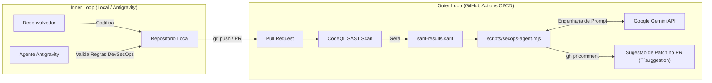

# 🛡️ Inserindo Agentes Autônomos na Cultura de DevSecOps

> **Palco CEIA — AI.Brasil Experience 2026**  
> Apresentador: Thiago Nunes  
> Tema: *"O novo fluxo de engenharia: Inserindo Agentes Autônomos na cultura de DevSecOps da equipe"*

---

## 🎯 Objetivo da Demonstração

Superar o modelo tradicional de DevSecOps (onde SAST/DAST apenas geram alertas e atrito, travando o *Lead Time for Changes* das métricas DORA) através do uso de **Agentes Autônomos** divididos em dois ciclos:

1. **Inner Loop (Ambiente Local / Antigravity):**
   - Regras de workspace (`.antigravity/rules/devsecops-agent.md`) que instruem o assistente local a auditar e blindar o código contra OWASP Top 10 antes do commit.
2. **Outer Loop (CI/CD no GitHub Actions):**
   - Esteira automatizada com CodeQL que, ao identificar uma vulnerabilidade e gerar um relatório SARIF, aciona o Agente de Remediação (`scripts/secops-agent.mjs`).
   - O agente se comunica com o **Google Gemini** e publica automaticamente no Pull Request uma **Sugestão de Alteração (*Suggested Change*)** pronta para ser aceita pelo desenvolvedor.

---

## 🏗️ Arquitetura da Solução



---

## 📂 Estrutura de Arquivos

- `src/services/userService.ts`: Serviço alvo contendo SQL Injection proposital para validação.
- `src/config/database.ts`: Conector simulado de banco de dados.
- `scripts/secops-agent.mjs`: Motor do Agente Autônomo com fallback resiliente entre modelos Gemini e integração ao GitHub CLI.
- `sarif-results/javascript.sarif`: Relatório SARIF representativo para demonstrações rápidas no palco (execução em ~8s).
- `.github/workflows/devsecops-agent.yml`: Pipeline do GitHub Actions configurado para remediação autônoma.
- `.antigravity/rules/devsecops-agent.md`: Diretriz de segurança para governança no Antigravity.

---

## 🚀 Como Executar Localmente

### Pré-requisitos
- Node.js 18+ (Node.js 20+ ou 24 recomendado)
- Variável de ambiente `GEMINI_API_KEY` configurada

### Testando o Agente Local
```bash
# Definir a chave
export GEMINI_API_KEY="sua_chave_aqui"
# No Windows PowerShell:
# $env:GEMINI_API_KEY="sua_chave_aqui"

# Executar o motor do agente
npm run agent
```

---

## 🎤 Roteiro de Demonstração no Palco (Cheat Sheet)

1. **Crie uma branch de demonstração:**
   ```bash
   git checkout -b feature/demo-busca-usuario
   ```
2. **Faça uma alteração em `src/services/userService.ts`**, commite e abra um Pull Request para `main`:
   ```bash
   git push origin feature/demo-busca-usuario
   ```
3. Abra a aba **Pull Requests** no GitHub:
   - Acompanhe o workflow `DevSecOps: Autonomous Triage Agent` rodando.
   - Em poucos segundos, visualize o comentário publicado pelo agente contendo o botão **Commit suggestion**.
   - Clique em **Commit suggestion** ao vivo no telão demonstrando o conceito **Human-in-the-Loop (HITL)**.